# Q(uick) Calc

A Spotlight-style scientific calculator for Mac and Windows. Press **Control + Option + Space** (**Alt + Space** on Windows) to calculate without leaving the app you’re in.

Type `sin(90)`, `72 f`, or `$10 for lunch + 15% tip` — the answer updates as you type.

## Features

Q Calc runs on Mac and Windows. A few of the newest features, marked *(Mac)*, are on the Mac first and come to Windows in a later update. On Windows, read **⌘** and **⌃** as **Ctrl** and **Option** as **Alt**; every shortcut can be changed under **Keybinds** in settings. Type `?` in the bar for a cheat sheet of keys and things to try, or `tutorial` for the walkthrough.

### The bar

- **Control + Option + Space** (**Alt + Space** on Windows) shows the calculator over whatever you're doing. **Esc** or a click outside hides it, and what you were typing is kept for a while (**Keep unfinished** in settings).
- The answer updates as you type, with a typeset preview of the expression underneath when it helps.
- Type as you would on a scientific calculator: `sin(90)`, `arcsin(0.5)`, `sin^-1(0.5)`, `sqrt(2)`, `2^8`, `5!`, `nCr(5,2)`, `GCF(12, 18)`, `LCM(4, 6)`, `80 + 15%`. Words become symbols as you type (`pi` → π, `sqrt` → √), with the square root drawn over what it covers.
- Grey parentheses show where Q Calc closes what you left open; **Tab** (or **→** at the end) types them in. **Tab** also accepts a completion.
- Units and functions are coloured as you type, and hovering a word names it (`ms` millisecond, `gcf` greatest common factor, `π` pi). A faint `°` or `rad` after a trig argument shows which angle mode it's read in.
- If a line can't be answered, a squiggle shows where and why.
- *(Mac)* **Stacked fractions and powers** (a setting, off by default): `/` puts what you typed over a fraction bar and `^` raises the power, as on a graphing calculator; **↑** and **↓** move between top and bottom.
- Pasted text becomes one plain line. On the Mac, **Bring in highlighted text** (settings) puts text you've highlighted in another app into the bar.

### Answers

- Exact and decimal side by side for roots and trig (`sqrt(3)/2 ≈ 0.866025`). **Answers → Exact** or **Approximate** picks which one **⌘C** and `ans` use; **Rationalize denominators** rewrites `5/sqrt(41)` as `5sqrt(41)/41`.
- **⌃D** switches degrees and radians, **⌃F** fraction answers, **⌃S** significant figures from the input (`12.0 kg + 3.15 kg` is `15.2 kg`). **⌃E** turns on exponent form (`3 × 10³`) and **⌃⇧E** cycles the other answer forms.
- Click an answer, or press **⌘C**, to copy it. Each half of an exact ≈ decimal answer copies on its own. **⌘⇧C** copies the whole line. Copies leave the unit off by default, and can be Typst-compatible.
- Select part of the line to see that part's answer on its own.
- Start a line with an operator to keep going from the last answer (`*2`), or type `ans`.
- *(Mac)* **⌃W** shows the working: derivatives by rule, integrals by parts or substitution, equations step by step.

### History

- **Enter** saves a calculation to the tape above the bar. **↑** and **↓** walk back through it, and **←** / **→** pick the expression or the answer. Clicking (or **Enter** on) a row inserts it at the cursor: `cos(` then a previous `31` becomes `cos(31)`.
- **⌘⌫** deletes a row and **⌘Z** brings it back. **⌃C** (**Ctrl + Shift + Backspace** on Windows) clears history and stored variables.
- Settings choose whether the tape shows recent rows, always, or only on **↑**, and whether a row inserts its expression or its answer.

<picture>
  <source media="(prefers-color-scheme: dark)" srcset="docs/screenshots/history-dark.png">
  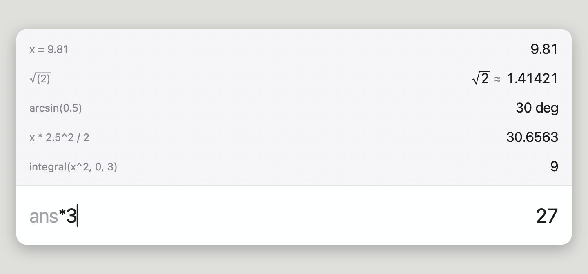
</picture>

### Units and measurement

- Type a value with units and add `to` for a target: `72 f`, `2 in to cm`, `5 ft 10 in to cm`, `3.2 atm to kPa`, `60 mph to m/s`. Units carry through the math (`$30/hr * 40 hr`, `10 mA * 4.7 kohm`).
- Feet and inches as builders write them: `6'2`, `5 3/8"`, `6'5 3/8"`, with answers in sixteenths when they're fractional.
- **Option + ↑** / **Option + ↓** step a unit through its metric prefixes (`4700 ohm` → `4.7 kΩ`) or *(Mac)* a length between feet-and-inches and feet.
- Any angle unit inside trig: `sin(90 deg)`, `cos(π/4 rad)`.
- Default units are set per quantity in settings.
- `conversion` or `metric prefixes` opens a sheet of the metric prefixes, common conversion factors and temperature formulas.

<picture>
  <source media="(prefers-color-scheme: dark)" srcset="docs/screenshots/units-dark.png">
  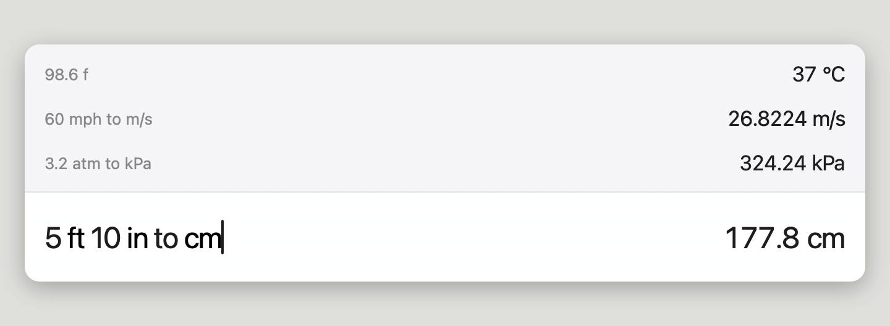
</picture>

### Uncertainty and significant figures

- Type `+/-` or `~` for ± (`-/+` for ∓), and the uncertainty carries through the calculation: `(9.81 ± 0.02) * (2.50 ± 0.01)` is `24.53 ± 0.15`.
- Significant figures follow the input when **⌃S** is on, so an answer rounds itself correctly.

<picture>
  <source media="(prefers-color-scheme: dark)" srcset="docs/screenshots/uncertainty-dark.png">
  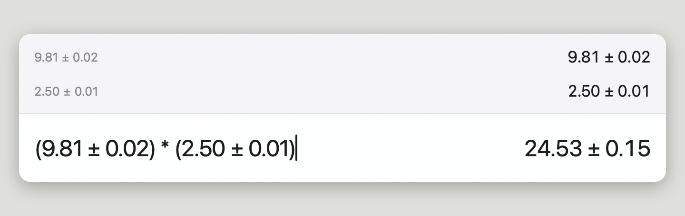
</picture>

### Algebra and solving

- Variables and functions: `x = 5`, then `x*2`; `f(x) = x^3`, then `f(2)`. Definitions after a `;` apply to that line alone: `x^2 + y; x=5; y=2`.
- Type an equation with `=` to solve it: `x^2 - 5x + 6 = 0` gives `x = 2, 3`, and every root copies on its own. `solve(x^2 - cos(x) = 0, x = 0.2)` starts Newton's method from a guess, and equations can carry units: `solve(0.5 = e^(-t/0.384 ms), t)` is `0.266 ms`.
- Rearrange a formula with `isolate`: `isolate T in PV = nRT` gives `T = P*V/(R*n)`. `solve y = mx + b for x` rearranges, or gives a number when every other letter is known.
- Systems of equations: `sys 2` through `sys 5` open fields that solve as you type, units included (`x + y = 10 m`, `x - y = 2 m` gives `x = 6 m, y = 4 m`). Nonlinear systems solve too, exactly when they can and numerically when not. In one line: `solve({x^2 + y^2 = 4, x^2 - y = 2})`.
- Summations: `sum n, n=1..9`, with the limits typed into small slots beside Σ.

<picture>
  <source media="(prefers-color-scheme: dark)" srcset="docs/screenshots/solve-dark.png">
  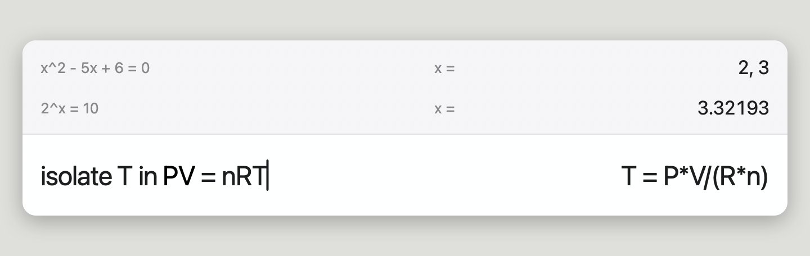
</picture>

<picture>
  <source media="(prefers-color-scheme: dark)" srcset="docs/screenshots/system-dark.png">
  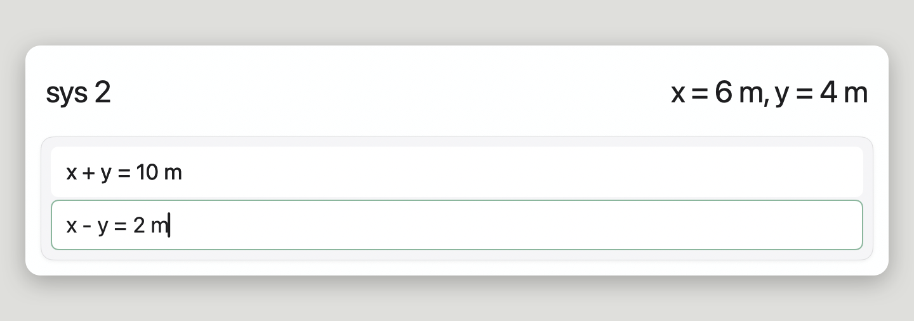
</picture>

### Calculus

- Derivatives: `d/dx x^2 sin(x)`.
- Definite integrals (`integral(x^2, 0, 3)`) and indefinite ones from a table (`∫ x e^x dx` is `x e^x - e^x + C`).
- Differential equations: `y' = …`, `dy/dx`, and linear equations of first or second order with constant coefficients (`y'' + y = 0`).
- Time derivatives for dynamics: `d/dt (x sin(theta))` is `ẋ sin(θ) + xθ̇ cos(θ)`, and `d²/dt²` works too. A row of chips shows which letters change with time; click one to switch it. Dotted variables can be typed `thetadot`, `dot(theta)` or `\dot\theta`, and LaTeX pastes straight in.

<picture>
  <source media="(prefers-color-scheme: dark)" srcset="docs/screenshots/calculus-dark.png">
  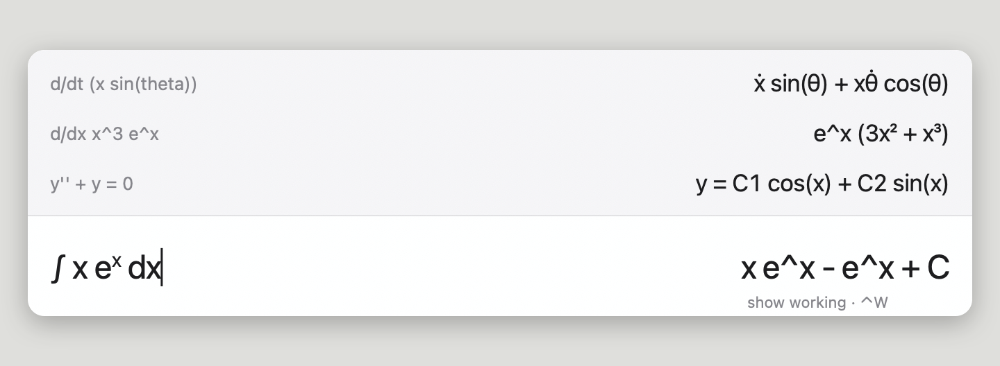
</picture>

### Matrices and vectors

- `[1 2; 3 4]` or `[[1,2],[3,4]]`, with `+`, `-` and `*` (a number scales, two matrices multiply rows by columns), `inv(A)`, `A^-1` or `inverse of A`, `det(A)` or `det A`, `A^T`, `A'` or `transpose A`, `trace(A)`, `rank(A)`, `rref(A)`, `identity(3)`, and `dot`, `cross` and `norm` for vectors. Entries can be any math (`[sqrt(2) 0; 0 1]`), answers show simple fractions beside the decimals, and a matrix answer becomes `ans`, so `*2` keeps going. Store one with `A = [1 2; 3 4]`. Sizes that don't fit say why, and a nearly singular matrix has no inverse rather than junk digits.

<picture>
  <source media="(prefers-color-scheme: dark)" srcset="docs/screenshots/matrix-dark.png">
  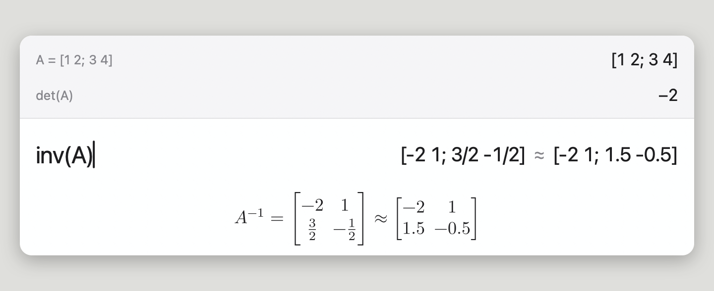
</picture>

### Complex numbers

- `i` or `j`: `(3+j4)/(1-j)`, `e^(j0.5)`, phasors like `10∠30`, `3+j4 in polar`, and complex values with units such as `(3+j4) kΩ`.

<picture>
  <source media="(prefers-color-scheme: dark)" srcset="docs/screenshots/complex-dark.png">
  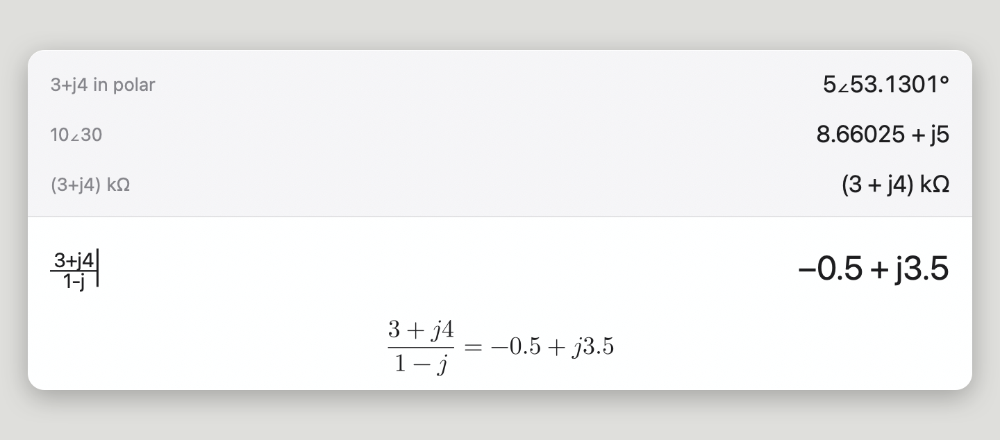
</picture>

### Graphing

- `graph x^3 - 3x`, `graph f`, or `graph f(x) = x^3` opens a graph under the bar with pan, zoom and a hover readout, and lists roots, maxima, minima and intercepts as chips that copy their value.
- *(Mac)* Implicit curves (`graph x^2 + y^2 = 25`), lines through points, and several equations on one graph (`graph a; b`, or the **+** in its header), each in its own colour.
- *(Mac)* Surfaces in 3D: `graph z = x^2 - y^2` opens a view you can orbit, pan and zoom, with minima, maxima and saddle points listed, or a contour view.
- The wrench opens graph settings: polar grid, axis labels, minor gridlines, Zoom Square and more.

<picture>
  <source media="(prefers-color-scheme: dark)" srcset="docs/screenshots/graph-dark.png">
  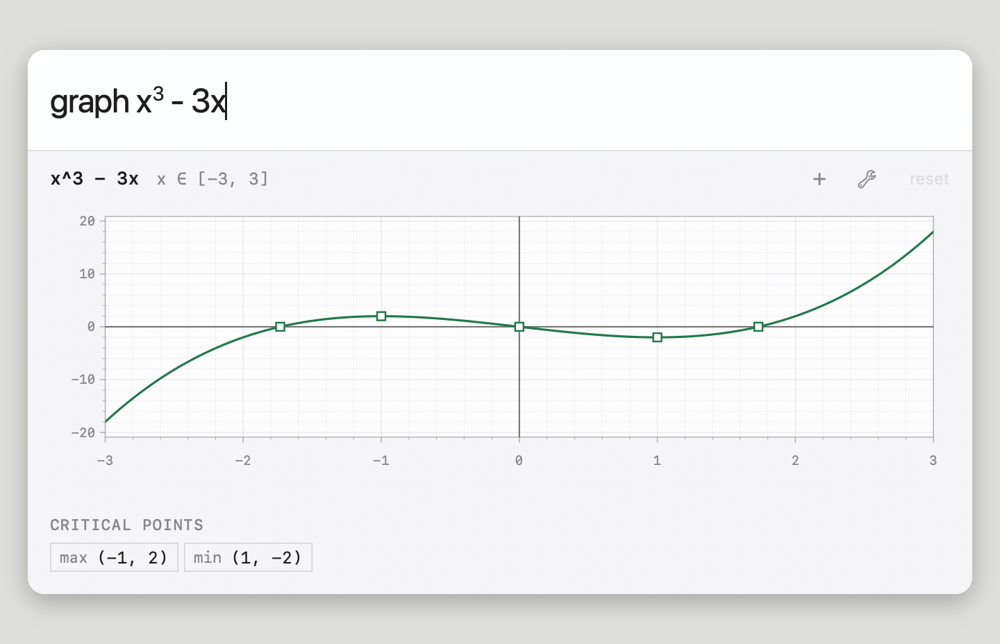
</picture>

<picture>
  <source media="(prefers-color-scheme: dark)" srcset="docs/screenshots/surface-dark.png">
  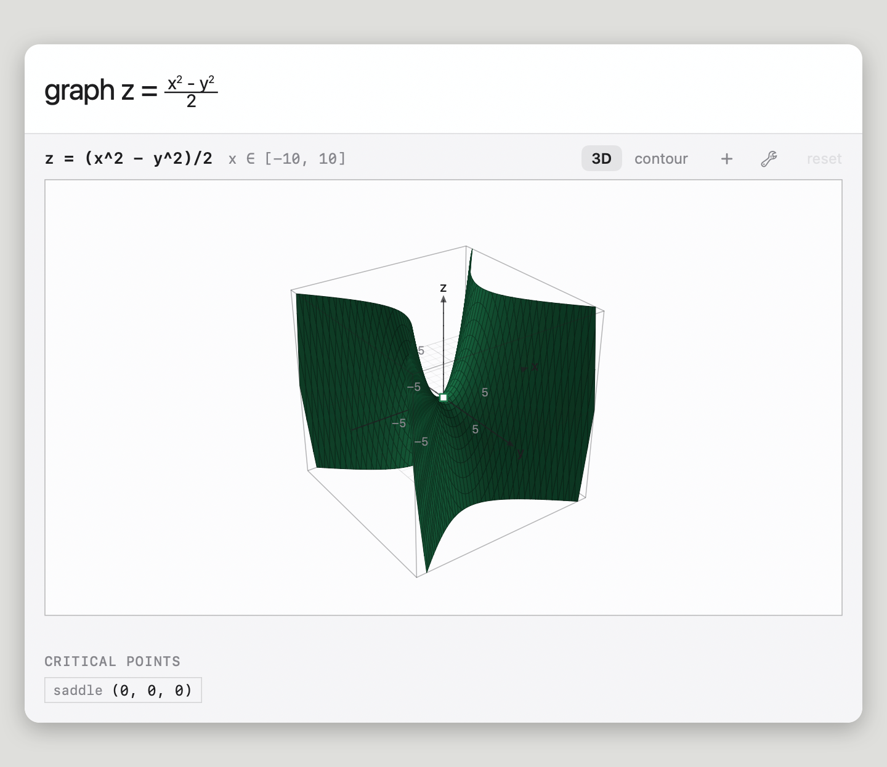
</picture>

### Chemistry and reference sheets

- `periodic table` (or `periodic`): click elements to build a formula (H, H, O is H₂O) and click it to insert its molar mass. A formula typed in the bar (`H2O`, `Ca(OH)2`, `molar mass of NaCl`) answers with its molar mass too.
- `identities` (or `idt`): trig, logs, algebra, partial fractions and summation. `integrals`, `unit conversions` and `constants` (CODATA physical constants) open sheets of their own. A click copies a row.
- *(Mac)* `formulas` lists every sheet, including chemistry, biology, physics, circuits, statistics, geometry, linear algebra, vector calculus, Taylor series, Fourier, Laplace and z-transform tables, and the unit circle. Each has a search field, and sheets open in one window with back and forward.

<picture>
  <source media="(prefers-color-scheme: dark)" srcset="docs/screenshots/periodic-dark.png">
  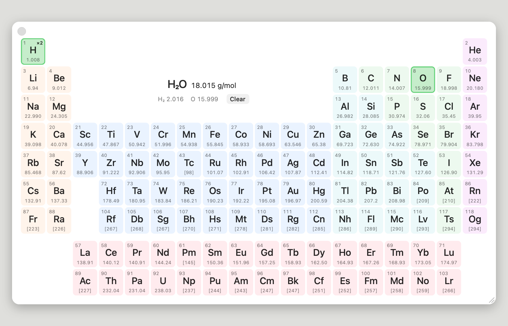
</picture>

<picture>
  <source media="(prefers-color-scheme: dark)" srcset="docs/screenshots/identities-dark.png">
  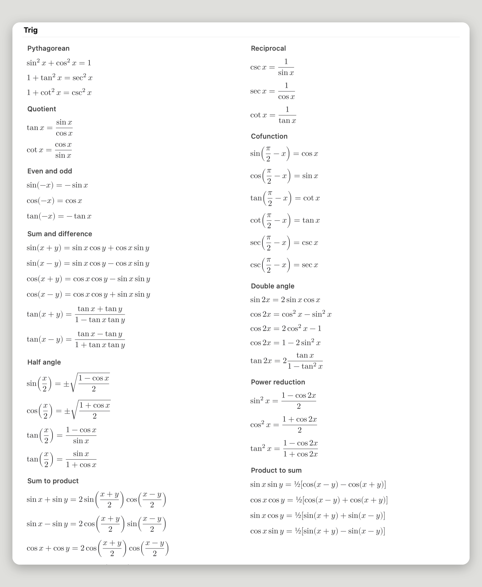
</picture>

### Everyday math

- `$10 for lunch + 15% tip`, `$45.50 + $12.25`, `40 is what % of 90`, `30 is 20% of what`.
- Dates and times: `today + 90 days`, `days until christmas`, `3:45pm + 4 hr 10 min`, `5pm - 9am`, `time in tokyo`.
- Currencies with daily rates from the European Central Bank: `100 usd to eur`, `$5 * 3 to eur`, `$5 + €3`, and `usd to eur` for the rate itself.

<picture>
  <source media="(prefers-color-scheme: dark)" srcset="docs/screenshots/calendar-dark.png">
  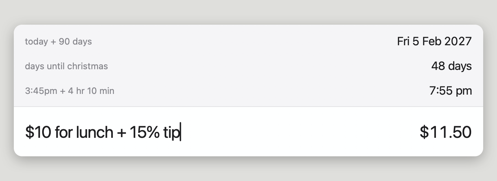
</picture>

### Messages and sharing

- `message <name>` (or `chat <name>`) sends someone a message, and `messages` shows your conversations.
- `paste to <name>` sends your clipboard, and `send file to <name>`, or dropping files on the bar, sends files. Clips and files are end-to-end encrypted; Q Calc warns you if someone's key changes and shows a safety code to compare.
- A message that arrives while the bar is hidden shows as a small note in the corner that never takes focus and stays quiet in full-screen apps and Do Not Disturb.

### Games

- Type `games` for the list, or a game's name: Pong, Connect 4, Ultimate tic-tac-toe, Crack, Equal (a daily puzzle), 24 / Countdown, Ember & Frost and Trails. Play against the computer or a friend online, by room list or code. **⌃F** makes a game full screen.

<picture>
  <source media="(prefers-color-scheme: dark)" srcset="docs/screenshots/games-dark.png">
  
</picture>

### Settings and the rest

- Every shortcut can be rebound under **Keybinds**. Light, dark or system appearance, a colour for units and functions, open at login, and Increase Contrast / Reduce Transparency / Reduce Motion respected.
- Updates install themselves in the background.
- A few surprises, for the curious: try dividing by zero, Euler's identity, `do a barrel roll`, or the Konami code.

## Installation

### Windows

You need **Windows 10** (any version from 1507, build 10240) **or Windows 11**, on an x64 or Arm PC. From 3.0, Q Calc for Windows is a native app ([native/windows](native/windows/README.md)): no web view, and nothing else to install.

Download `Q-Calc-<version>-x64-native-setup.exe` (or `-arm64-native-setup.exe` for Snapdragon PCs) from the [latest release](https://github.com/maxconine/Q-Calc/releases/latest) and run it. It installs for your account only, so there's no admin prompt, and adds Q Calc to the Start menu and **Installed apps**. An older Q Calc (2.x) updates itself to 3.0 in place and keeps its settings and history.

> [!NOTE]
> The installer isn't code-signed yet, so Windows may say it protected your PC. Click **More info → Run anyway**. Updates after that install silently, and never show this.

Q Calc runs in the notification area. Windows 11 puts new icons under the **^** on the taskbar; drag it onto the taskbar to keep it in view. Click it to show the calculator, or right-click it for **Settings…** and **Quit**.

Q Calc opens when you sign in. Turn that off with **Open at login** in settings (**Ctrl + ,**).

If **Alt + Space** opens something else (PowerToys Run and Command Palette use it too), open settings, click **Choose keybinds…** under **Keybinds**, then click the **Show / hide Q Calc** key and press a new one. Any shortcut in that list can be changed the same way. If another app already holds the shortcut when Q Calc starts, the calculator says so.

Q Calc checks for updates once a day and installs them while you're away from the PC. See [src-tauri/release/README.md](src-tauri/release/README.md) for the details, and [native/windows/RELEASE.md](native/windows/RELEASE.md) for how a Windows release is shipped.

### Mac

Install via Homebrew to get autoupdates (Preferred)

You need [Homebrew](https://brew.sh), a Mac with **macOS 12 Monterey** or later (Apple silicon or Intel).

```bash
brew tap maxconine/qcalc https://github.com/maxconine/Q-Calc
brew trust --tap maxconine/qcalc
brew install --cask maxconine/qcalc/q-calc
zsh "$(brew --prefix)/Library/Taps/maxconine/homebrew-qcalc/macos/enable-autoupdate.sh"
```

Or:

```bash
/bin/zsh -c "$(curl -fsSL https://raw.githubusercontent.com/maxconine/Q-Calc/main/macos/install.sh)"
```

> [!NOTE]
> By using Q Calc, you acknowledge that it's not notarized.
>
> Homebrew automatically deletes the `com.apple.quarantine` attribute, so the app should work out of the box without a warning that “Apple cannot check Q Calc for malicious software.”
>
> Daily Homebrew upgrades for Q Calc are turned on at install. Opt out with `macos/install.sh --no-autoupdate`, or later with `brew autoupdate stop`.

The Q Calc icon appears in the menu bar. It does not show in the Dock.

If **Control + Option + Space** does nothing, macOS is often using that shortcut for Input Sources. Turn the shortcut off in **System Settings → Keyboard → Input Sources → Edit**.

To start Q Calc at login, add it under **System Settings → General → Login Items & Extensions**.

To upgrade immediately instead of waiting for the daily check:

```bash
brew update
brew upgrade --cask q-calc
```

## Development

The JavaScript engine can be tried in a browser. Natural-language math needs the Mac app.

```bash
npm install
npm run dev
```

Open http://localhost:5173/

```bash
npm test
```

Runs the engine suite, including the scientific checklist in `src/engine/scientific.test.ts`.

### Build the Mac app from source

Install [Xcode 26](https://developer.apple.com/xcode/) or later from the Mac App Store, open it once, then accept the license:

```bash
sudo xcode-select -s /Applications/Xcode.app/Contents/Developer
sudo xcodebuild -license accept
```

Xcode 26 or later is required, and Node.js 20 or later (`brew install node`).

```bash
npm install
npm run mac:install
```

That compiles Q Calc and copies **Q Calc.app** into `/Applications`. An older **Instant Solver.app** in Applications is removed.

```bash
npm run mac          # macos/dist/Q Calc.app, for this Mac's chip
npm run mac:package  # macos/dist/Q-Calc-<version>-apple-silicon.zip and -intel.zip, for release
```

If the clone is in **Documents** or **Desktop**, macOS may refuse to launch the repo build directly — use `npm run mac:install` or the Homebrew cask.

### Ship an update to field Macs

The current public release is **v2.0.15**. That is the GitHub Release, the zips linked from the download page, and the Homebrew cask.

Each release has two Mac zips: `Q-Calc-<version>-apple-silicon.zip` and `Q-Calc-<version>-intel.zip`. Each carries only its own chip's code, so it's about half the size of a universal app. Homebrew picks the right one.

To publish the next version:

1. Bump `"version"` in `package.json`.
2. Point the Apple silicon and Intel zip links in `docs/index.html` at that same version.
3. Commit, then tag and push that version:

```bash
git tag v$(node -p "require('./package.json').version")
git push origin main v$(node -p "require('./package.json').version")
```

The **Release** GitHub Action builds both zips, publishes them on GitHub Releases, and updates `Casks/q-calc.rb`, `docs/appcast.xml` (Apple silicon) and `docs/appcast-intel.xml` (Intel). Installed copies, from the zip or Homebrew, update themselves within a day (see below), or immediately with **Check for Updates…** in the menu bar menu or `brew upgrade --cask q-calc`. You can also run **Release** from the Actions tab without pushing a tag.

### Automatic updates

The app updates itself with [Sparkle](https://sparkle-project.org). Once a day it reads its feed from GitHub Pages (`docs/appcast.xml` on Apple silicon, `docs/appcast-intel.xml` on Intel) and downloads a newer zip in the background. The update installs when Q Calc quits, or when the Mac has been idle for 30 minutes with no Q Calc window open, and Q Calc reopens on its own. **Update automatically** in Settings turns this off; Sparkle then asks before installing.

The Release action signs each zip with an EdDSA key. One-time setup, done by a repo admin:

1. Run `zsh macos/build.sh` once so Sparkle's tools land in `macos/vendor`.
2. Create the key in your login Keychain. This prints the public key:

   ```bash
   macos/vendor/Sparkle-2.10.0/bin/generate_keys --account q-calc
   ```

3. Put that public key in `macos/Info.plist` as `SUPublicEDKey` (replacing `SPARKLE_PUBLIC_KEY_PLACEHOLDER`) and commit it. `npm run mac:package` refuses to build a release while the placeholder is there.
4. Copy the private key into the `SPARKLE_PRIVATE_KEY` repository secret, then delete the exported file:

   ```bash
   KEY="$(mktemp)"
   macos/vendor/Sparkle-2.10.0/bin/generate_keys --account q-calc -x "$KEY"
   gh secret set SPARKLE_PRIVATE_KEY < "$KEY"
   rm "$KEY"
   ```

5. In **Settings → Pages**, deploy from the `main` branch, `/docs` folder, so `https://maxconine.github.io/Q-Calc/appcast.xml` loads.

Keep the private key safe and backed up. Q Calc is ad-hoc signed, so Sparkle trusts an update only if this key signed it. If the key is lost, installed copies can never update again and everyone has to download the zip by hand.

## Privacy

Q Calc sends anonymous usage counts, such as how many calculations used units or how often the history was used. It never sends what you type or the answers. Each install gets a random ID that isn't tied to you, and the counts go out at most every few hours. To turn this off, open Settings and switch off **Share anonymous usage**; that also deletes the ID. The collector and dashboard live in [analytics/](analytics/README.md).

## License

Q Calc is [MIT](LICENSE).

